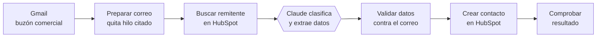
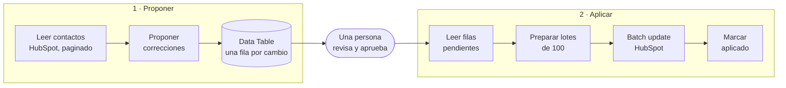
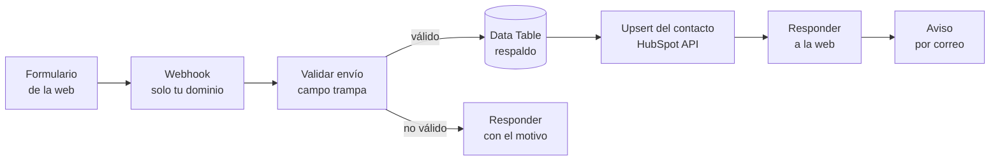
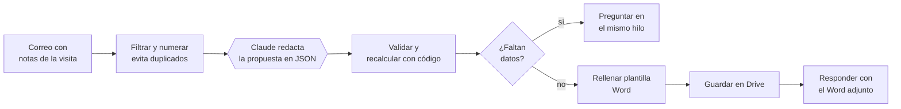

# Flujos de n8n: CRM, automatización e IA

Flujos de [n8n](https://n8n.io) que he diseñado y puesto en producción para empresas B2B,
publicados aquí en **versión anonimizada**: la arquitectura y el código son los reales; los
nombres, dominios, identificadores y reglas de negocio de cada cliente se han sustituido por
valores de ejemplo.

> **In English.** Production n8n workflows I built for B2B companies, published in anonymized
> form: an AI email-to-CRM lead classifier, a two-step CRM data cleanup with human approval, a
> website-form-to-HubSpot pipeline (live on my own site), and the architecture of an AI quote
> generator. Code and docs are in Spanish. More about my work at
> [exponencialesfirm.com/en](https://exponencialesfirm.com/en/).

| # | Flujo | Qué resuelve | Piezas |
|---|---|---|---|
| 01 | [Correo comercial → CRM](#01--correo-comercial--crm) | Los contactos que llegan por correo dejan de cargarse a mano en el CRM | Gmail · Claude · HubSpot API |
| 02 | [Limpieza de contactos con aprobación](#02--limpieza-de-contactos-con-aprobación) | Corrige miles de contactos sin riesgo: primero propone, después aplica | HubSpot API · Data Tables |
| 03 | [Formulario web → CRM](#03--formulario-web--crm) | Los contactos de la web entran solos al CRM, sin pasar por el filtro de spam | Webhook · HubSpot API · Data Tables · Gmail |
| 04 | [Cotizaciones automáticas](#04--cotizaciones-automáticas-arquitectura) | De unas notas por correo a una propuesta en Word, lista para enviar | Gmail · Claude · Drive · Word |

Una idea se repite en todos: **el modelo propone y el código decide**. La IA redacta,
clasifica o extrae; después, código normal valida cada dato antes de que toque el CRM o salga
hacia un cliente.

---

## 01 · Correo comercial → CRM

**Problema.** En el buzón comercial entran a diario posibles clientes y personas derivadas
("quien ve esto es Luis, lo dejo en copia"). Alguien tenía que leerlos y crear cada contacto a mano.

**Qué hace.** Una vez al día lee el buzón, clasifica cada correo y crea en HubSpot solo a quien
corresponde, con su fuente de origen.



**Decisiones de diseño**

- **Salida estructurada.** El modelo devuelve un JSON con esquema fijo (`derivacion`,
  `solicitud_directa` u `otro`), no texto libre.
- **El modelo no puede inventar destinatarios.** Solo se crean contactos cuyo email aparece
  literalmente en el correo. La lista de candidatos se arma antes, con código.
- **Sin el hilo citado.** Se corta el historial de respuestas para que el modelo lea solo el
  mensaje nuevo: menos coste y menos confusiones.
- **No pisa datos existentes.** Si el contacto ya está en el CRM, no se toca (un `409` se trata
  como "ya existía", no como error).
- **Hereda contexto del CRM.** Si la persona derivada es de la misma empresa que el remitente,
  toma su empresa e industria.
- **Los errores se ven.** Si HubSpot rechaza un contacto, la ejecución falla con el detalle.

Archivos: [`workflows/01-correo-a-crm.json`](workflows/01-correo-a-crm.json) ·
código en [`code/01-correo-a-crm/`](code/01-correo-a-crm/) ·
[prompt](code/01-correo-a-crm/prompt-clasificador.md)

---

## 02 · Limpieza de contactos con aprobación

**Problema.** Una base de contactos con años de carga manual: nombres en mayúsculas, apellidos
repetidos, teléfonos en diez formatos, erratas en los dominios, empresas llamadas "n/a".
Corregirlo directamente en el CRM es arriesgado: no hay deshacer.

**Qué hace.** Dos flujos separados, con una persona en medio.



**Decisiones de diseño**

- **Proponer no modifica nada.** El primer flujo solo escribe en una tabla: una fila por cambio,
  con el valor actual, el propuesto y la regla que lo originó.
- **Tres niveles de confianza.** Los cambios seguros (espacios, mayúsculas, formato de teléfono)
  salen aprobados. Los dudosos (separar nombre y apellido, erratas de dominio) quedan para
  revisar. Lo que el código no sabe arreglar se marca como `FLAG:` y nunca se aplica solo.
- **Reversible.** El valor anterior queda guardado en la tabla.
- **Reintentable.** Solo se marcan como aplicadas las filas de los lotes que HubSpot confirma.
  Si un lote falla, sus filas siguen pendientes.
- **Reglas explícitas, sin IA.** Aquí un modelo no aporta: son reglas deterministas que se pueden
  leer, probar y auditar.

**Columnas de la Data Table:** `contact_id`, `lead_status`, `bloque`, `campo`, `valor_actual`,
`valor_propuesto`, `regla` (texto) · `revisar`, `aprobado`, `aplicado` (booleanos) · `url`, `lote` (texto).

Archivos: [`workflows/02a-limpieza-crm-proponer.json`](workflows/02a-limpieza-crm-proponer.json) ·
[`workflows/02b-limpieza-crm-aplicar.json`](workflows/02b-limpieza-crm-aplicar.json) ·
código en [`code/02-limpieza-crm/`](code/02-limpieza-crm/)

---

## 03 · Formulario web → CRM

**Funciona en vivo** en el formulario de contacto y la lista de espera de
[exponencialesfirm.com](https://exponencialesfirm.com/#contacto).

**Problema.** Quería un formulario con el diseño de mi web, no el incrustado de HubSpot. Pero
los envíos que llegan a HubSpot por su API pública de formularios, sin las señales del formulario
incrustado, acaban en la carpeta de spam y no crean el contacto.

**Qué hace.** El formulario de la web envía los datos a un webhook de n8n, que crea el contacto
directamente por la API de CRM, con un token propio. A esa vía HubSpot no le aplica el filtro de
spam.



**Decisiones de diseño**

- **Primero se guarda, después se envía.** Cada envío queda en una Data Table antes de llamar a
  HubSpot. Si HubSpot falla, el contacto no se pierde y el aviso por correo lo dice.
- **Crear o actualizar en una sola llamada.** El *upsert* por email evita duplicados cuando
  alguien escribe dos veces.
- **Los campos vacíos no se envían**, para no borrar datos que el contacto ya tenía en el CRM.
- **La web recibe la respuesta antes del aviso por correo**, así el visitante no espera a Gmail.
- **Defensa en dos capas.** El navegador valida para dar avisos claros; el flujo vuelve a validar,
  porque el webhook es público. El campo trampa frena a los robots sin molestar a las personas.
- **CORS solo para tu dominio**, configurado en el propio nodo Webhook.
- **La lista de espera usa el mismo flujo**: llega marcada con `tipo = lista_espera` y queda
  identificada en el mensaje del contacto.

**Columnas de la Data Table:** `fecha`, `tipo`, `nombre`, `apellido`, `correo`, `telefono`,
`mensaje`, `pagina` (todas de texto).

Archivos: [`workflows/03-formulario-web-a-crm.json`](workflows/03-formulario-web-a-crm.json) ·
código en [`code/03-formulario-web/`](code/03-formulario-web/), con un
[formulario HTML de ejemplo](code/03-formulario-web/formulario-ejemplo.html) que ya le habla al flujo.

---

## 04 · Cotizaciones automáticas (arquitectura)

**Problema.** Preparar cada propuesta comercial llevaba horas: pasar las notas de la visita a un
documento, calcular cantidades y totales, dar formato.

**Qué hace.** El comercial envía sus notas por correo con una etiqueta en el asunto y recibe en
el mismo hilo la propuesta en Word, o una pregunta si falta algún dato.



**Decisiones de diseño**

- **Los números no los hace el modelo.** Claude redacta y estructura; cantidades y totales se
  recalculan con código antes de generar el documento.
- **Si falta un dato, pregunta.** En vez de inventar un precio o una medida, responde en el
  mismo hilo pidiendo lo que falta.
- **Plantilla del cliente.** El Word se genera desde su plantilla, con su formato de siempre.
- **Registro y versiones.** Cada propuesta queda numerada y versionada; un mismo correo no
  genera dos propuestas.

Este flujo se publica **solo como arquitectura**: su código contiene las reglas de precios y
cálculo del cliente, que no me corresponde publicar.

---

## Cómo usarlos

1. En n8n: **Workflows → Import from file** y elige un JSON de [`workflows/`](workflows/).
2. Conecta las credenciales que pide cada flujo (no viene ninguna incluida):
   Gmail (OAuth2), HubSpot (token de app privada, como *Bearer Auth*) y Anthropic.
3. Sustituye los valores de ejemplo: `tuempresa.com`, `tudominio.com`, `tu@correo.com`,
   `TU_PORTAL_ID` y `REEMPLAZAR_ID_DATA_TABLE`.
4. Revisa las listas propias de cada negocio (industrias, normalización de teléfonos, pensada para Chile).

## Cómo está organizado

```
workflows/   JSON listos para importar en n8n
code/        el código de cada nodo, como archivos legibles
scripts/     build.js genera los JSON desde code/ · probar.js ejecuta las pruebas
```

El código de los nodos vive en `code/` y los JSON se generan desde ahí, para que se pueda leer y
revisar sin abrir n8n:

```bash
node scripts/build.js    # regenera workflows/*.json
node scripts/probar.js   # prueba la lógica con datos inventados
```

Las pruebas cubren la lógica de los nodos de código. Las versiones anonimizadas de los flujos 01 y
02 no se han ejecutado de punta a punta contra cuentas reales; el 03 es la versión genérica del que
funciona en mi web. Antes de usarlos en producción, pruébalos en tu propio entorno.

---

Juanjo Lazcano · [exponencialesfirm.com](https://exponencialesfirm.com) · Consultor de CRM, automatización e IA
